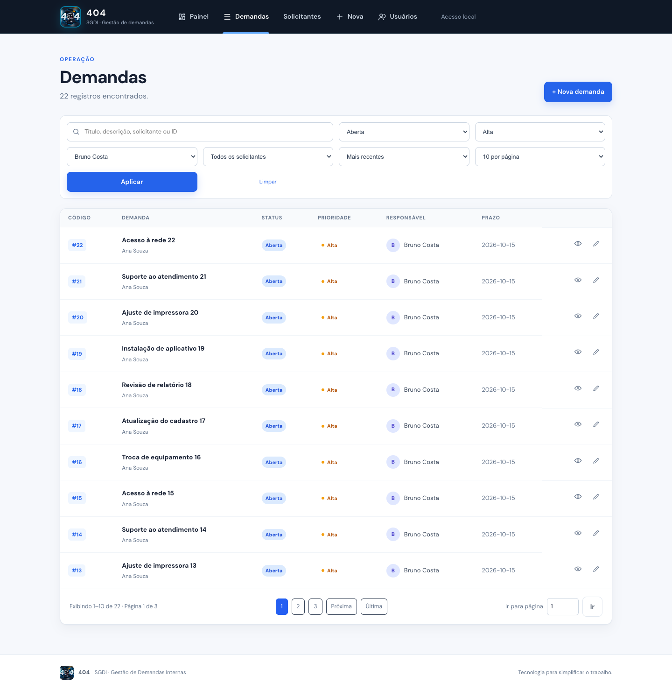
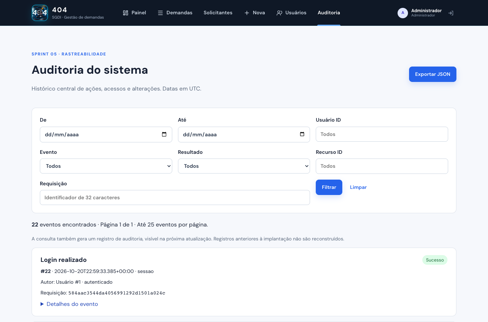

<p align="center">
  
</p>

<h1 align="center">SGDI 404</h1>

<p align="center">
  <strong>Sistema de Gestão de Demandas Internas</strong><br>
  Organize solicitações, acompanhe prazos e consulte o histórico das operações.
</p>

<p align="center">
  <a href="https://github.com/DALMOL1N/404/actions/workflows/testes.yml"></a>
  
  
  
</p>

<p align="center">
  <a href="#sobre-o-projeto">Sobre</a> ·
  <a href="#funcionalidades">Funcionalidades</a> ·
  <a href="#comece-pela-demonstracao">Executar</a> ·
  <a href="#testes-e-evidencias">Testes</a> ·
  <a href="#equipe-404">Equipe</a>
</p>

---

<a id="sobre-o-projeto"></a>

## Sobre o projeto

O **SGDI 404** centraliza o cadastro e o acompanhamento de demandas internas. Cada solicitação reúne título, descrição, solicitante, prioridade, responsável, status e prazo, com filtros para encontrar o que precisa de atenção.

O projeto evoluiu ao longo de sete sprints, acrescentando cadastro de usuários, consultas, indicadores gerenciais, auditoria e integração por API. A aplicação utiliza **Python, Flask e SQLite**, com interface em HTML, CSS e JavaScript.

> **Sprint 7 em integração.** O banco e o backend da API já estão na `main`. A ativação dos endpoints depende também da publicação do contrato OpenAPI e do console de integração. O pacote de testes e a documentação da Sprint 7 ainda precisam ser incorporados. O sistema web e a demonstração continuam disponíveis durante essa etapa.

<a id="funcionalidades"></a>

## Funcionalidades

| Área | O que o sistema oferece |
| --- | --- |
| **Demandas** | Cadastro, edição, consulta, exclusão, comentários e histórico. |
| **Pessoas e perfis** | Solicitante vinculado a usuário cadastrado e permissões por perfil no modo autenticado. |
| **Busca e filtros** | Pesquisa combinada com status, prioridade, responsável, solicitante e vencimento. |
| **Prazos** | Todas, atrasadas, vencem hoje, próximos sete dias ou sem prazo definido. |
| **Navegação** | Ordenação e paginação de 10, 25 ou 50 registros, preservando os filtros. |
| **Exportação e ações rápidas** | CSV do conjunto filtrado, alteração rápida de status e opção de assumir uma demanda. |
| **Painel gerencial** | Indicadores, gráficos, acompanhamento de atrasos e tempo de resolução. |
| **Auditoria** | Registro de operações, consulta paginada e exportação JSON para perfis autorizados. |
| **API REST** | Banco e backend publicados. Console, contrato e testes estão na etapa final de integração. |

### Telas do sistema

<details>
<summary><strong>Ver capturas da listagem e da auditoria</strong></summary>

As imagens abaixo são registros de versões anteriores entregues, com dados de demonstração.

**Consulta com filtros combinados — Sprint 3**



**Auditoria de operações — Sprint 5**



</details>

<a id="comece-pela-demonstracao"></a>

## Comece pela demonstração

A demonstração utiliza **144 demandas fictícias**, em um banco separado, para explorar combinações de status, prioridades, responsáveis e prazos. Reiniciar a carga acrescenta cenários ausentes e preserva as edições dos registros existentes.

### Windows

1. Instale **Python 3.11 ou superior**, com o launcher `py` ou a opção **Add Python to PATH**.
2. Baixe o repositório em **Code → Download ZIP** e extraia a pasta inteira.
3. Abra **`DEMO_SPRINT7_WINDOWS.bat`**.
4. Aguarde a preparação do ambiente e acesse **http://127.0.0.1:5070/**.

A primeira execução precisa de internet para instalar as dependências. Para escolher outro modo, abra **`INICIAR_WINDOWS.bat`**.

### macOS e Linux

No terminal, dentro da pasta do projeto:

```bash
python3 -m venv .venv
source .venv/bin/activate
python -m pip install -r requirements.txt
python demo_sprint7.py
```

Abra **http://127.0.0.1:5070/**. Para encerrar o servidor, use **Ctrl+C** no terminal.

### Contas da demonstração

| Perfil | E-mail | Senha |
| --- | --- | --- |
| Administrador | `admin@404.local` | `DemoSprint7!2026` |
| Gestor | `gestor@example.test` | `DemoSprint7!2026` |
| Colaborador | `colaborador@example.test` | `DemoSprint7!2026` |
| Leitor | `leitor@example.test` | `DemoSprint7!2026` |

Essas contas e senhas são **públicas e fictícias**, exclusivas da demonstração. Para trabalhar com seus próprios dados, utilize o modo autenticado e escolha uma senha própria.

### Outros modos de execução

Com o ambiente preparado e ativado:

| Modo | Comando | Endereço | Uso |
| --- | --- | --- | --- |
| Demonstração atual | `python demo_sprint7.py` | `http://127.0.0.1:5070/` | 144 cenários fictícios e perfis de exemplo. |
| Autenticado | `python iniciar_autenticado.py` | `http://127.0.0.1:5056/` | Senha própria, solicitada na primeira execução. |
| Local sem login | `python app.py` | `http://127.0.0.1:5050/` | Uso na própria máquina, com autoria técnica “Operação local”. |
| Demonstração da Sprint 5 | `python demo_sprint5.py` | `http://127.0.0.1:5056/` | Base fictícia anterior para consultar a auditoria. |

Os modos da porta `5056` devem ser executados um por vez. No Windows, o menu `INICIAR_WINDOWS.bat` oferece essas opções e a execução dos testes.

## Integração por API

O backend da Sprint 7 prepara as rotas sob `/api/v1`, com autenticação **Bearer**, tokens com expiração e revogação, validação de dados e autorização por perfil. As mudanças de negócio e os eventos de auditoria compartilham a mesma transação.

Na `main` atual, a API permanece desativada até a integração de `docs/openapi.json` e `templates/api_docs.html`. Com esses componentes presentes, o console fica disponível em **`/api/docs`**.

O estado da integração e a divisão dos pacotes estão em [Integração da Sprint 7](docs/INTEGRACAO_SPRINT7.md) e [Commits por integrante](docs/COMMITS_SPRINT7.md).

<a id="testes-e-evidencias"></a>

## Testes e evidências

Com o ambiente virtual ativado, execute:

```bash
python -m unittest discover -s tests -v
```

A suíte cria bancos temporários para verificar cadastro, migrações, filtros, paginação, indicadores, permissões, auditoria e integração. Os testes não utilizam o banco operacional.

**Conferência local de 16/11/2026:** 68 testes aprovados na `main` com os pacotes de banco e backend; 100 testes aprovados em uma cópia isolada com os pacotes pendentes de interface e testes. O segundo resultado não representa a versão já publicada no GitHub.

O workflow [Testes Windows e Linux](https://github.com/DALMOL1N/404/actions/workflows/testes.yml) executa a suíte em ambos os sistemas. Consulte a execução do commit desejado para conferir seu resultado.

Registros disponíveis no repositório:

- [Integração até a Sprint 5](evidencias/testes-integracao-main-sprint5.txt).
- [Validação anterior da integração da Sprint 7](evidencias/testes-main-integracao-sprint7.txt).
- [Validação anterior da montagem completa dos pacotes](evidencias/testes-montagem-pacotes-sprint7.txt).
- [Capturas e exportações de auditoria](evidencias/).

Cada evidência mantém a data e o escopo da execução que a gerou. Os totais são de versões diferentes e não devem ser somados.

## Evolução por sprint

| Sprint | Entrega principal |
| --- | --- |
| **1** | Base do sistema e fluxo de cadastro e acompanhamento de demandas. |
| **2** | Solicitante vinculado a um usuário cadastrado. |
| **3** | Filtros combinados, ordenação e paginação. |
| **4 — Emergencial** | Painel gerencial, indicadores e ciclo de conclusão. |
| **5** | Auditoria central com preservação dos eventos após exclusões. |
| **6** | Contribuição externa: CSV da listagem filtrada e ações rápidas. |
| **7** | Filtros compartilhados, demonstração ampliada e integração por API REST. |

A contribuição da Sprint 6 foi recebida de **Ricardo Drews, de outro grupo**, com seu commit original preservado no histórico.

## Estrutura do projeto

```text
app.py                  Aplicação web e integração dos módulos
init_db.py              Inicialização e migrações do banco
database.py             Conexões e transações SQLite
consultas.py            Critérios compartilhados de busca e filtros
catalogo.py             Status, prioridades, perfis e ordenações
analytics.py            Indicadores do painel gerencial
auditoria.py            Registro, consulta e exportação de eventos
audit_schema.py         Estrutura da auditoria
api.py                  Backend REST da Sprint 7
api_schema.py           Estrutura de tokens e limites de autenticação
dados_demonstracao.py   Carga dos cenários fictícios
demo_sprint7.py         Inicialização da demonstração atual
templates/              Páginas HTML
static/                 Logo, estilos e scripts
tests/                  Testes automatizados
docs/                   Decisões, integração e divisão de entregas
evidencias/             Registros de testes e capturas do sistema
```

## Dados, acesso e limites

- O banco é criado ou migrado na inicialização. As migrações previstas que alteram o esquema geram backup e preservam os registros existentes.
- Demandas antigas com solicitante em texto livre podem exigir conciliação manual com o usuário correto.
- O modo sem login utiliza uma conta técnica administrativa. Para identificar pessoas e aplicar permissões individuais, use o modo autenticado.
- Banco, `.venv`, `.env`, `.session-secret` e credenciais reais ficam fora do versionamento.
- Os inicializadores escutam em `127.0.0.1`. Para disponibilizar o sistema na internet, é necessária uma hospedagem com backend Python e configuração adequada de acesso e HTTPS. GitHub Pages não executa o backend Flask.
- SQLite e as agregações em memória atendem à demonstração e às bases pequenas verificadas. Não há resultado de teste de carga nesta entrega.
- A auditoria preserva os eventos após excluir demandas e evita registrar senhas, tokens e textos livres. Quem administra diretamente o arquivo SQLite mantém controle sobre o armazenamento.

<a id="equipe-404"></a>

## Equipe 404

| Integrante | Responsabilidade na G2 |
| --- | --- |
| **Ricardo Trento Werner** | Banco de dados e migrações. |
| **Naubert Piva Migliavacca** | Backend e segurança. |
| **Murilo Trevisol Dalmolin** | Tech Lead, arquitetura e integração. |
| **Gabriel Pasuch Granja** | Product Owner, requisitos e frontend. |
| **Tino Markus Bueno Navarro** | Testes, evidências e entrega. |

Os commits e os registros de revisão identificam as contribuições publicadas. A divisão de responsabilidades não substitui a confirmação individual do trabalho realizado.

---

<p align="center">
  <strong>Equipe 404</strong><br>
  Projeto acadêmico de gestão de demandas internas.
</p>
